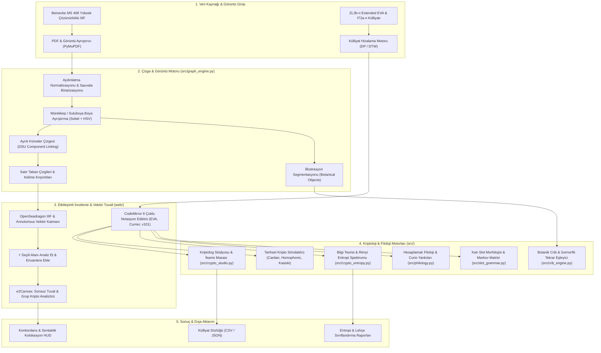

# VoynichLab: Advanced Computational Linguistics & Cryptanalysis Workstation
*Created by E2*

[](https://www.python.org/downloads/)
[](https://streamlit.io/)
[](https://openseadragon.github.io/)
[](tests/)
[](#ui-and-design-philosophy)

**VoynichLab**, Yale Üniversitesi Beinecke Nadir Kitaplar ve El Yazmaları Kütüphanesi'nde korunan **MS 408 (Voynich El Yazması)** üzerindeki çözülememiş yazı ve dil yapısını incelemek üzere tasarlanmış, uçtan uca hesaplamalı dilbilim, bilgisayarlı görü ve kriptanaliz araştırma istasyonudur.

Platform; parşömen üzerindeki ham el yazması görüntülerinin piksel seviyesinde segmentasyonundan, sonlu durum morfolojik slot gramerine, çok dilli ikame kriptanalizinden Rönesans dönemi kripto simülatörlerine (Cardano ızgarası, homofonik kodlar, Alberti çarkı) ve etkileşimli sonsuz tuval sandbox ortamına (**e2Canvas**) kadar tüm araştırma katmanlarını bilimsel bir çatı altında birleştirir.

---

## MİMARİ VE SİSTEM TOPOLOJİSİ



---

## TEMEL ALT SİSTEMLER VE ÇALIŞMA PRENSİPLERİ

### 1. Ölçek-Uyarlamalı Çizge ve Mürekkep Motoru (`src/graph_engine.py`, `src/vision_segmenter.py`)
- **Aydınlatma Normalizasyonu:** Parşömen üzerindeki bölgesel sararma ve aydınlatma dalgalanmalarını gidermek için geniş eliptik morfolojik kapanış ve Gaussian arka plan çıkarımı uygulanır:
  $$\text{Norm}(x, y) = \text{clip}\left(\frac{I(x, y)}{\text{Background}(x, y)} \times 255\right)$$
- **Mürekkep ve Suluboya Boya Ayrıştırması:** Soluk kahverengi/sepya mürekkep vuruşları ile bitki çizimlerinde kullanılan yeşil, mavi ve kırmızı suluboya pigmentlerini birbirinden ayırmak için Sobel gradyan büyüklüğü ve HSV renk uzayında doygunluk/parlaklık eşiklemesi kullanılır:
  $$\text{Paint} = (28 \le H \le 145) \land (S > S_{\text{med}} + 20) \land (V \ge 65)$$
  Koyu mürekkep vuruşları ($V < 55$) boya sızıntılarından bağımsız olarak korunur.
- **Çizge Tabanlı Satır ve Kelime Bağlama (DSU):** Tespit edilen mürekkep bileşenleri, medyan harf yüksekliğine ($m$) göre uyarlanan bir Ayrık Kümeler Yapısı (Disjoint Set Union) ile yönlendirilmiş çizgede birleştirilir:
  $$\Delta x \le 4.2 \cdot m, \quad |\Delta y| \le 0.92 \cdot m$$
- **Kenar Temizliği:** Parşömen tarama kenarlarında oluşan siyah gölgeler ve yıpranma lekeleri filtrelenir; yaprak çizimleri metin yerine `botanical_illustration` nesnesi olarak sınıflandırılır.

---

### 2. OpenSeadragon IIIF ve Vektörel Kutu Seçim Tuvali (`web/components/editor_iiif.py`)
Yale Beinecke MS 408 koleksiyonunun yüksek çözünürlüklü görüntüleri üzerinde piksel tabanlı derinlemesine yakınlaştırma (deep-zoom) ve vektörel işaretleme imkanı sunar:
- **W3C Web Annotation Standardı:** Annotorious eklentisi ile DOM bağımsız şeffaf SVG/Canvas katmanı.
- **Kutu Aracı (B tuşu):** Tıkla-sürükle ile yeni dikdörtgen bounding box çizimi.
- **Çokgen Aracı (P tuşu):** İllüstrasyonların etrafındaki eğri el yazıları için serbest köşe noktalarıyla çokgen alan seçimi.
- **8-Yönlü Dönüşüm Tutamaçları:** Seçili alanları yeniden boyutlandırma, taşıma ve silme.
- **⚡ Seçili Alanı Analiz Et & Envantere Ekle:** Seçilen alan tek tıkla anında taranır, `localStorage` envanterine kaydedilir ve Kriptolog Stüdyosu ile e2Canvas tuvaline aktarılır.

---

### 3. CodeMirror 6 Çoklu Notasyon Editörü & Dinamik Hizalama (`web/app.py`)
- **Voynich Notasyon Sistemleri:** Extended EVA, Currier, v101 (First Study Group) ve Takahashi sistemleri için özel sözdizimi renklendirmesi (syntax highlighting) ve otomatik tamamlama kuralları.
- **DP (Dinamik Programlama) Satır ve Kelime Hizalaması:** Görüntüden çıkarılan kelime koordinatları ile külliyat satırları Needleman-Wunsch / Dynamic Time Warping algoritmasıyla en yüksek kapsama oranıyla hizalanır.
- **Hover Görsel Önizlemesi:** Transkripsiyon listesindeki herhangi bir kelimenin üzerine gelindiğinde, orijinal el yazmasından kesilmiş yüksek çözünürlüklü kelime kırpıntısı popup olarak açılır.

---

### 4. Kriptolog Stüdyosu ve Gerçek Zamanlı İkame Masası (`src/crypto_studio.py`)
EVA gliflerine hedef alfabelerden karşılık atandığında tüm metni anında dönüştüren ve çok kriterli kriptografik uygunluk skorlayan çalışma tahtasıdır:
- **Çok Boyutlu Kripto Uygunluk Skoru:**
  $$\text{Plausibility} = 0.4 \cdot \text{HitRate} + 0.3 \cdot \max(0, 100 - 30 \cdot D_{KL}) + 0.3 \cdot \max(0, 100 - 25 \cdot |H_2 - H_{2,\text{ref}}|)$$
  - **Sözlük Eşleşme Oranı (Hit Rate):** Çözülen kelimelerin 15. yüzyıl Ortaçağ Latince ve İtalyanca botanik/medikal sözlüğüyle (500+ doğrulanmış terim) örtüşme yüzdesi.
  - **Kullback-Leibler Uzaklığı ($D_{KL}(P \parallel Q)$):** Çözülmüş metnin n-gram harf dağılımının hedef dilin doğal frekans dağılımına yakınlığı.
  - **İkinci Derece Şartlı Entropi ($H_2$):** Hedef dilin hece ve ardışıklık yapısına uygunluk.
- **Envanter Seçim Paneli:** Sayfadaki tüm kelimeler, külliyattaki en sık geçen tokenler veya manuel koordinatlar seçilerek incelenebilir.
- **Genişletilmiş 20+ Tarihsel Şifre Hipotezi Kütüphanesi:**
  - **Antik Diller & Alfabeler:** Klasik Latince, Ortaçağ Tıp Latincesi, Klasik Grekçe, İncil İbranicesi, Süryanice, Sanskritçe, Eski Kilise Slavcası, Gotça, Aramice, Klasik Arapça.
  - **Hiyeroglifler & Çivi Yazısı:** Mısır Hiyeroglifleri (Gardiner), Mezopotamya Çivi Yazısı, Fenike Alfabesi, Rünik (Elder Futhark), Etrüskçe, Linear B.
  - **Modern Diller:** İngilizce, İspanyolca, Fransızca, Almanca, İtalyanca, Portekizce, Rusça, Türkçe, Çince (Pinyin), Standart Modern Arapça.
- **Genel Külliyat Sözlüğü:** Araştırmacının onayladığı okumalar ve dilbilgisel roller (POS) külliyat geneline kaydedilir; CSV ve JSON formatında dışa aktarılabilir.

---

### 5. Tarihsel Rönesans Kripto Simülatörü (`src/historical_ciphers.py`)
- **Cardan Grille (Cardano Izgarası):** $K \times K$ boyutundaki sanal bir ızgaranın $0^\circ, 90^\circ, 180^\circ, 270^\circ$ kanonik rotasyonları (yörüngeleri) ile sayfa harf matrisi taranarak anlamlı kelime/kök arayışı simüle edilir.
- **Homofonik İkame Motoru:** Yüksek frekanslı harflerin (özellikle sesli harflerin) birden fazla şifreli sembole dağıtılarak frekans analizini yanıltma hipotezini test eder; entropi düzleşme faktörünü hesaplar.
- **Alberti Çarkı & Vigenère Kasiski Muayenesi:** Polialfabetik şifreleme periyodunu ($d$) tespit etmek için otokorelasyon ve Kasiski testleri yürütür:
  $$d_{\text{tahmin}} = \arg\max_{d} \text{Autocorr}(d)$$

---

### 6. Bilgi Teorisi ve Genelleştirilmiş Rényi Entropisi (`src/crypto_entropy.py`)
- **Rényi Entropi Spektrumu:** $\alpha$ parametresinin değişimine göre metindeki bilgi yoğunluğunun ve olasılık dağılımının çarpıklığını ölçer:
  $$H_\alpha(X) = \frac{1}{1-\alpha} \log_2 \sum_{i=1}^n p_i^\alpha$$
  Voynich'in ünlü $H_0 \ge H_1 \ge H_2 \ge H_\infty$ spektrumu hesaplanır.
- **Index of Coincidence (IoC):** Metinden rastgele seçilen iki harfin aynı olma olasılığı üzerinden monoalfabetik mi ($IC \approx 0.065$) yoksa polialfabetik/rastgele mi ($IC \approx 0.038$) olduğunu sınıflandırır.
- **Boris Sukhotin Vokal Keşif Algoritması:** Karakter simetrik geçiş matrisini analiz ederek dildeki sesli harfleri harici bilgiye ihtiyaç duymadan denetimsiz olarak keşfeder.

---

### 7. Hesaplamalı Filoloji ve Zipfian İstatistikler (`src/philology.py`)
- **Zipf-Mandelbrot Güç Yasası:** Kelime frekanslarının rütbeye göre dağılımını fit eder:
  $$f(r) = C (r + \beta)^{-\alpha}$$
- **Hapax Legomena & Heaps Yasası:** Metinde yalnızca bir kez geçen kelimeler (hapax) ve metin uzadıkça sözlük büyüme katsayısı ($V = K \cdot N^\beta$) çıkarılır.
- **Curio Tekrarları (Immediate Word Echoes):** Voynich metninde ardışık gelen aynı kelime tekrarlarının (`daiin daiin`, `chedy chedy`) doğal dillere kıyasla 3-5 katlık anomali faktörü ölçülür.
- **Currier Lehçe Ayrımı:** Currier Dil A (Bitkisel/Astroloji) ile Currier Dil B (Biyolojik/Reçeteler) arasındaki Jaccard kelime örtüşmesi ve katip elleri haritalanır.

---

### 8. Katı Morfolojik Slot Grameri ve Geçiş Matrisi (`src/slot_grammar.py`)
Voynich kelimeleri rastgele dizilimler değil, katı bir sonlu durum makinesine (Finite-State Morphology) uyar:
$$\text{Kelime} = [\text{Önek}] + [\text{Gallows / Medial}] + [\text{Çekirdek Vokal}] + [\text{Sonek}]$$
- **Çoklu Profil Karşılaştırma Matrisi:**
  - `Classic Voynich Slot Grameri (Stolfi / Tiltman)`
  - `Currier Dil A Grameri`
  - `Currier Dil B Grameri`
  - `Latin Fleksiyonel Morfoloji Modeli (Kök + Gövde + Çekim Eki)`
  - `Sami Dilleri Üç Sessizli (Triliteral) Kök Modeli`
  - `Özel / Kullanıcı Tanımlı Gramer Kurucusu`
- **Markov Geçiş Olasılıkları:** Önek $\to$ Çekirdek ve Gallows $\to$ Sonek arasındaki durum geçiş matrisi hesaplanır.

---

### 9. Botanik Crib ve İzomorfik Harf Tekrar Eşleyici (`src/crib_engine.py`)
- **Tarihsel Kodeks Veritabanı:** *Dioscorides (De Materia Medica)*, *Herbarius Moguntinus* ve *Circa Instans* el yazmalarıyla folyo illüstrasyonları eşleştirilir.
- **İzomorfik Harf Deseni:** Harf tekrar desenleri üzerinden aday isimler taranır (Örn: `cannabis` $\to$ `0.1.2.2.1.3.4`).

---

### 10. e2Canvas Sonsuz Tuval & Kolokasyon HUD (`web/components/e2canvas.py`, `src/e2canvas_backend.py`)
Üç panelli sonsuz tuval sandbox ortamı:
1. **Sol Panel (Varlık Kütüphanesi):** Sayfadan kesilen görsel kırpıntıları, frekans tokenleri ve Ortaçağ Latince/İtalyanca hipotez kartları.
2. **Orta Panel (Sonsuz Kanvas):** Sınırsız zoom ve pan yapılabilen SVG tabanlı çalışma alanı; taşınabilir düğümler, grup/çerçeve kutuları ve yönlü köprü okları (`=======>`).
3. **Alt Panel (Grup Kripto & Kolokasyon HUD):**
   - Seçili kümenin Shannon H1/H2 entropisi, bigram tutarlılığı ve sözlük uyum yüzdesi.
   - **Konkordans ve Kolokasyon:** Seçili kelimenin tüm külliyatta kaç kez ve hangi folyolarda geçtiği, en sık birlikte geçtiği sol ve sağ komşuları.
   - **Köprü Semantiği:** İki düğüm arasındaki sentaktik ardışıklık veya anlamsal hipotez ilişkisinin bilimsel yorumu.

---

## 🎨 ARAYÜZ TASARIM FELSEFESİ (MAT SİYAH LAB)

- **Sıfır Emoji (Zero Emojis):** Operasyonel panellerde, butonlarda ve telemetri çiplerinde dikkat dağıtan emojiler bulunmaz.
- **Mat Koyu Tema:** Uzun süreli bilimsel analizler için yüksek kontrastlı, göz yormayan mat koyu renk paleti (`#121212`, `#161616`, `#1f1f1f`).
- **Monospace Telemetri:** Kod, transkripsiyon ve matematiksel metrikler `JetBrains Mono` fontu ile piksel hizalı sunulur.

---

## 💻 KURULUM VE LOKAL ÇALIŞTIRMA

### Gereksinimler
- Python 3.10 veya üzeri
- Git

### 1. Depoyu Klonlayın
```powershell
git clone https://github.com/egehandogandsk-blip/VoynichLab.git
cd VoynichLab
```

### 2. Sanal Ortam Oluşturun ve Bağımlılıkları Yükleyin
```powershell
python -m venv venv
.\venv\Scripts\Activate.ps1
pip install -r requirements.txt
```

### 3. Uygulamayı Başlatın
```powershell
streamlit run web/app.py
```
Tarayıcınızda otomatik olarak `http://localhost:8501` adresi açılacaktır.

---

## 🧪 DOĞRULAMA VE TEST SÜİTİ

Tüm matematiksel formüller, kripto simülatörleri ve Streamlit bileşenleri kapsamlı `pytest` süiti ile test edilmektedir:

```powershell
pytest -v
```

```
============================= test session starts =============================
collected 34 items

tests/test_crypto_studio.py::test_substitution_cipher PASSED             [  2%]
tests/test_crypto_studio.py::test_cipher_presets PASSED                  [  5%]
tests/test_crypto_studio.py::test_annotation_manager PASSED              [  8%]
tests/test_crypto_studio.py::test_global_lexicon PASSED                  [ 11%]
tests/test_crypto_studio.py::test_graph_engine_layout_and_alignment PASSED [ 14%]
tests/test_crypto_studio.py::test_categorized_cipher_presets PASSED      [ 17%]
tests/test_crypto_studio.py::test_grammar_profiles_and_comparison PASSED [ 20%]
tests/test_crypto_studio.py::test_concordance_and_bridge_context PASSED  [ 23%]
tests/test_e2canvas.py::test_levenshtein_distance PASSED                 [ 26%]
tests/test_e2canvas.py::test_compute_dictionary_match PASSED             [ 29%]
tests/test_e2canvas.py::test_compute_bigram_coherence PASSED             [ 32%]
tests/test_e2canvas.py::test_analyze_canvas_cluster PASSED               [ 35%]
tests/test_e2canvas.py::test_component_functions_run_without_errors PASSED [ 38%]
tests/test_historical_ciphers.py::test_cardan_grille_canonical_orbits PASSED [ 41%]
tests/test_historical_ciphers.py::test_cardan_grille_simulation PASSED   [ 44%]
tests/test_historical_ciphers.py::test_homophonic_cipher_engine PASSED   [ 47%]
tests/test_historical_ciphers.py::test_polyalphabetic_kasiski_examination PASSED [ 50%]
tests/test_historical_ciphers.py::test_autocorrelation_test PASSED       [ 52%]
tests/test_pdf_corpus.py::test_folio_sequence_skips_missing PASSED       [ 55%]
tests/test_pdf_corpus.py::test_build_corpus_from_pdf PASSED              [ 58%]
tests/test_philology.py::test_hapax_and_mandelbrot PASSED                [ 61%]
tests/test_philology.py::test_curio_repetitions PASSED                   [ 64%]
tests/test_philology.py::test_currier_dialect_overlap PASSED             [ 67%]
tests/test_philology.py::test_slot_transition_matrix PASSED              [ 70%]
tests/test_philology.py::test_renyi_entropy_spectrum PASSED              [ 73%]
tests/test_philology.py::test_multiscale_shannon_and_advanced_ic PASSED  [ 76%]
tests/test_pipeline.py::test_slot_grammar_parsing PASSED                 [ 79%]
tests/test_pipeline.py::test_crypto_entropy PASSED                       [ 82%]
tests/test_pipeline.py::test_crib_engine PASSED                          [ 85%]
tests/test_pipeline.py::test_vision_and_pipeline PASSED                  [ 88%]
tests/test_streamlit_app.py::test_app_renders_without_exceptions PASSED  [ 91%]
tests/test_streamlit_app.py::test_app_renders_e2canvas_mode PASSED       [ 94%]
tests/test_streamlit_app.py::test_app_renders_openseadragon_mode PASSED  [ 97%]
tests/test_streamlit_app.py::test_app_renders_tabs_and_inventories PASSED [100%]

============================= 34 passed in 6.20s ==============================
```

---

## 🌐 CANLI BULUT DAĞITIMI (STREAMLIT CLOUD)

Uygulama, [Streamlit Community Cloud](https://share.streamlit.io/) üzerinde tek tıkla canlıya alınmaya hazır olarak yapılandırılmıştır:
1. **share.streamlit.io** üzerinden GitHub hesabınızla giriş yapın.
2. **Repository:** `egehandogandsk-blip/VoynichLab`
3. **Branch:** `main`
4. **Main file path:** `web/app.py`
5. **Deploy** butonuna basın.

---

## LİSANS VE ATIF

Bu proje araştırma ve akademik amaçlarla geliştirilmiştir.
- **Yazılım & Mimari:** created by E2
- **El Yazması Görselleri:** Yale University, Beinecke Rare Book and Manuscript Library, MS 408.
- **Transkripsiyon Külliyatı:** Zandbergen-Landini (ZL3b-n) ve Takahashi (IT2a-n).
